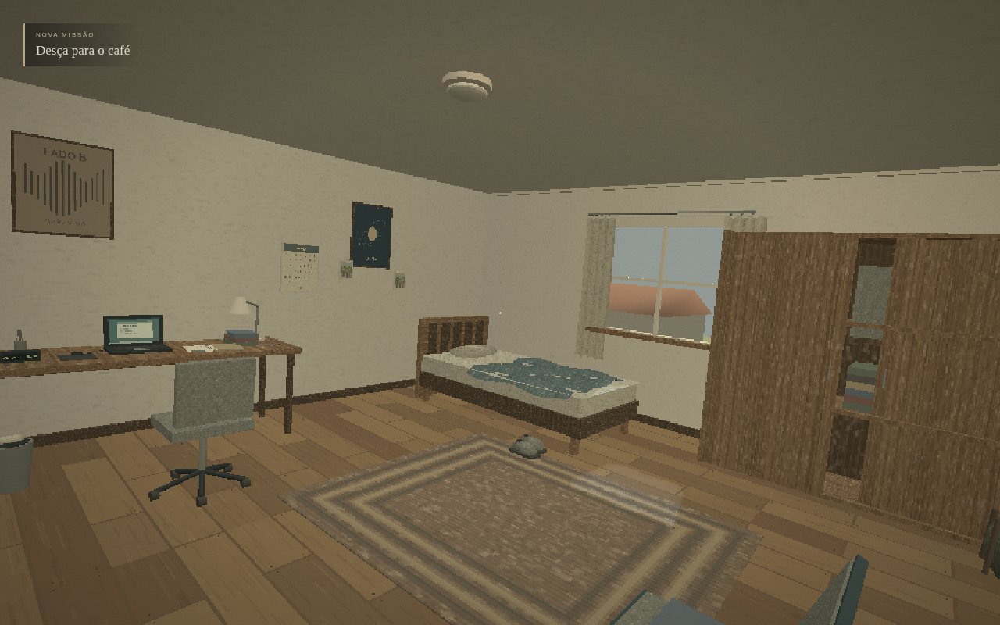
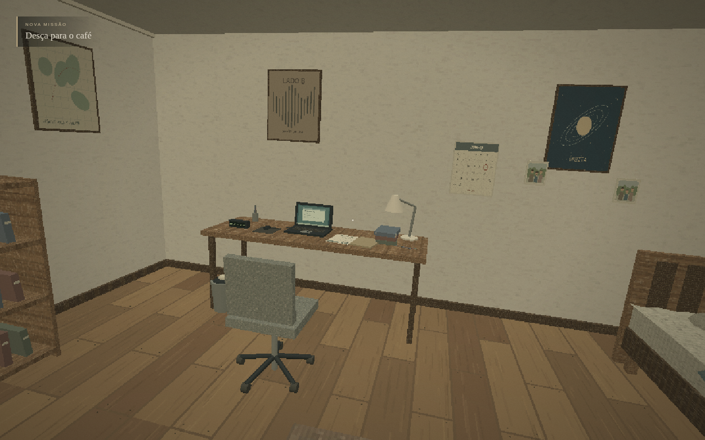

# O Intercâmbio — O Despertar

**Protótipo 01 · versão 0.1.0.** Cena 3D navegável em primeira pessoa, feita com **TypeScript, Babylon.js e Vite**. Um adolescente acorda em casa antes de sua viagem de intercâmbio. A missão é simples: **Desça para o café**.

O protótipo cobre o despertar, o quarto, o corredor e a descida da escada. A estética usa geometria trabalhada, texturas pequenas e luz quente da manhã, inspirada nos jogos do começo dos anos 2000. A interface permanece legível em resolução nativa.



## Abrir no computador com Windows

1. Instale **Node.js 24 ou superior**, disponível em [nodejs.org](https://nodejs.org/). Não é necessário abrir a janela do Node.js.
2. Extraia o ZIP inteiro do projeto.
3. Abra a pasta que contém **package.json** e **INICIAR-O-INTERCAMBIO.bat**.
4. Dê dois cliques em **INICIAR-O-INTERCAMBIO.bat**.
5. O navegador abrirá o jogo. Clique em **Começar**.

O ZIP de entrega inclui a cena já compilada em **dist/**. Com Node.js instalado, o inicializador usa esse build e o servidor HTTP local do próprio Node, sem instalar pacotes npm. Em uma cópia apenas do código-fonte, o mesmo `.bat` prepara as dependências e usa o servidor de desenvolvimento.

Mantenha a janela do inicializador aberta enquanto joga. Para encerrar, feche essa janela. Se o navegador não abrir sozinho, digite na barra de endereços o endereço exibido pelo inicializador.

No ZIP pronto, se a porta estiver ocupada, o inicializador procura outra automaticamente. No servidor de desenvolvimento, feche a janela da sessão anterior antes de abrir outra; fechar apenas a aba do navegador não encerra o servidor. Não abra `index.html` com dois cliques. O inicializador foi preparado neste ambiente Linux e não foi executado em Windows.

## Jogar

A abertura dura aproximadamente **13,5 segundos**. O protagonista começa deitado, abre os olhos, ouve a mãe e se levanta. O movimento livre fica bloqueado durante essa sequência e é liberado na posição final da câmera.

| Ação | Controle |
| --- | --- |
| Andar | WASD |
| Olhar | Mouse |
| Correr | Segurar Shift |
| Interagir com objeto próximo sob a mira | E |
| Pausar ou continuar | Esc |
| Retomar a captura do mouse | Clicar no cenário ou em “Clique para olhar com o mouse” |
| Reiniciar a cena | Menu de pausa → Reiniciar cena |

Se a captura do mouse não estiver disponível, segure o botão esquerdo e arraste para olhar. A indicação de interação aparece ao mirar perto de um objeto: a porta abre e fecha sobre a dobradiça, o interruptor alterna a luz e a mala, o calendário e a fotografia podem ser examinados. Examinar esses três objetos é opcional.

Saia pela porta, atravesse o corredor e desça a escada. Ao alcançar o último degrau, aparece **OBJETIVO CONCLUÍDO**, seguido de **Fim do Protótipo 01 — O Despertar**. O botão **Repetir cena** volta ao despertar.

## Configurações

As configurações estão na tela inicial e no menu de pausa:

- Sensibilidade do mouse, de **0,2× a 2,5×**.
- Balanço suave da câmera, com opção de desligar.
- Volume e legendas.
- Qualidade **Baixa**, **Equilibrada** ou **Alta**, que ajusta a resolução interna da cena.
- Granulação discreta e indicador opcional de desempenho.

As preferências são guardadas neste navegador. Se o armazenamento estiver indisponível, continuam valendo na sessão. A posição do jogador e o progresso da cena não são salvos; uma nova sessão começa novamente na cama.

## Voz e ambiência

A mãe diz a frase exata do roteiro:

> **MÃE:** Ei, vem tomar café pra não se atrasar!

O WAV incluído é **voz sintética provisória e substituível**, em português brasileiro, gerada offline com eSpeak NG `pt-br+f3`. Não é uma gravação humana natural final. O arquivo existe, tem cerca de **3,18 segundos** e é carregado localmente; não depende de síntese de voz do navegador ou de serviço externo.

A fonte sonora fica no andar inferior, com direção, redução por distância e filtro de abafamento. Vento, pássaros, relógio, ruídos domésticos, passos, roupa, cama, maçaneta e porta usam síntese original em Web Audio. O áudio começa após o gesto de início e acompanha a pausa.

Veja a [documentação sonora](docs/AUDIO-PROTOTIPO-01.md), o [inventário da voz](public/audio/voice-info.json) e as [instruções para substituir o WAV por uma gravação humana](public/audio/README.md).



## Instalar, executar e gerar o build

O ZIP com **dist/** pronto pode ser servido diretamente com Node.js **24 ou superior**:

```bash
node scripts/serve-built.mjs
```

Para desenvolver a partir do código-fonte, abra a pasta de `package.json` e execute:

```bash
npm ci
npm run dev
```

O servidor de desenvolvimento usa **http://localhost:5180**. Para gerar e abrir os arquivos de produção:

```bash
npm run build
npm run preview
```

O build fica em **dist/**, e a prévia do Vite usa **http://localhost:4180**. Sirva esses arquivos por HTTP; abrir o HTML diretamente por `file://` não executa o projeto corretamente. O servidor local apenas entrega arquivos estáticos. Não é necessário backend, conta de jogador ou API paga.

Depois de alterar o código-fonte, use `npm run dev` para trabalhar ou rode `npm run build` novamente. O `.bat` prefere o build existente em `dist/`.

## Verificação

```bash
npm run typecheck
npm test
npm run build
CHROMIUM_PATH=/usr/bin/chromium npm run verify
```

`verify` executa tipos, testes e build, inicia uma prévia temporária de produção na porta **4181** e percorre o fluxo com Chromium. O navegador precisa estar instalado; `CHROMIUM_PATH` informa seu executável. Com um servidor de desenvolvimento já aberto, `npm run test:browser` executa a suíte separadamente.

O [registro de validação](docs/VALIDACAO-PROTOTIPO-01.md) reúne o método e os resultados das execuções, capturas e medições. Os testes incluem abertura, controles, colisões, porta física, interações, pausa, configurações e descida real da escada. A existência dos comandos não comprova uma execução aprovada. Resultados de FPS devem ser lidos junto ao ambiente e ao perfil medidos; esta documentação não promete 60 FPS em qualquer computador.

Nesta entrega passaram **35 testes**, TypeScript, build e quatro perfis no Chromium. O servidor Linux com **SwiftShader, sem GPU física**, mediu **7,9 a 14,5 FPS** conforme o perfil; a meta de 60 FPS ainda não foi atingida nesse ambiente. O ZIP extraído também foi jogado até o final pelo navegador, sem instalar dependências do projeto.

## Código e escopo

| Módulo | Responsabilidade |
| --- | --- |
| `src/scene/` | Geometria, materiais, texturas, objetos e iluminação |
| `src/game/opening.ts` | Despertar e eventos da abertura |
| `src/game/player.ts` e `collision.ts` | Mouse, movimento e colisões |
| `src/game/door.ts` e `interactions.ts` | Porta articulada e interação por mira |
| `src/game/audio.ts` | Ambiência, efeitos e fala espacializada |
| `src/game/settings.ts` | Preferências do navegador |
| `src/game/objective.ts` | Ativação e conclusão única da missão no último degrau |
| `src/ui.ts` e `src/style.css` | Interface, máscaras das pálpebras e aparência |
| `src/main.ts` | Integração dos componentes e ciclo da cena |

Este é um projeto independente. A cena segue o [roteiro do Protótipo 01](docs/ROTEIRO-PROTOTIPO-01.md), sem reutilizar código, assets ou estados de outros jogos da área de trabalho. O recorte termina na escada: não inclui escola, cidade estrangeira, monstros, acontecimentos sobrenaturais, combate, inventário ou outros capítulos. O alvo desta entrega é navegador de computador.

Geometria, texturas e efeitos procedurais são produzidos para este projeto. A procedência da ferramenta usada na voz provisória está registrada na pasta de áudio, incluindo o texto de licença; o sintetizador não precisa ser instalado para jogar.

## Entrega local

O arquivo `vercel.json` já configura a importação do projeto na Vercel. Veja o [passo a passo de publicação](docs/PUBLICAR-NA-VERCEL.md), com os campos exatos e a conferência do jogo após publicar.

Os endereços `localhost` acima funcionam no computador onde o inicializador está aberto. A criação do repositório remoto no GitHub não foi concluída neste ambiente; não há endereço público de repositório ou prévia confirmado nesta entrega.
