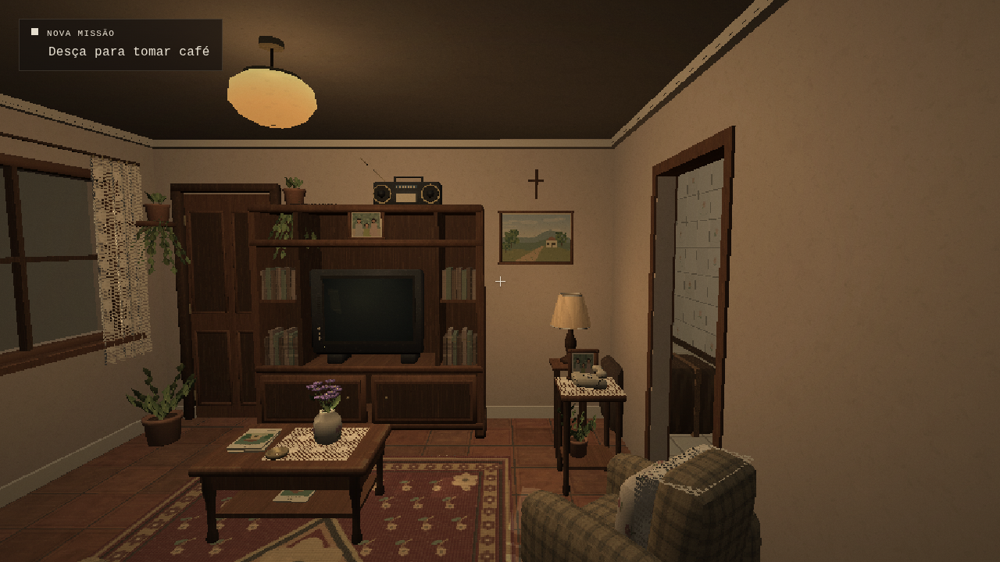
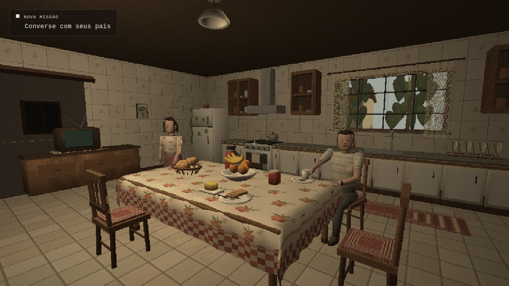

# Correção da posição da sala de estar

O visual da sala de **INTERCÂMBIO** já estava aprovado. Esta correção altera sua posição e integração no térreo: quarto → corredor superior → escada original → sala de estar diretamente à frente → cozinha. O [relatório da entrega visual](RECONSTRUCAO-SALA.md) continua como registro da etapa anterior.

## Implementação

A planta local aprovada permanece em `src/game/livingRoomLayout.ts`. O novo `src/game/livingRoomPlacement.ts` aplica ao conjunto uma rotação de 180° e translação, sem alterar escala ou disposição interna:

```text
x mundo = 5,55 − x local
z mundo = 23,85 − z local
y mundo = y local
```

A sala fica em `x = −1,32…2,88`, `z = 12,00…15,80`, no piso `y = 0`. Sua entrada está alinhada ao eixo da escada, em `x = 1,40…2,30`; a passagem para a cozinha fica no lado leste, entre `z = 13,75…14,65`.

Móveis, decorações, janela e luzes se deslocam juntos. Materiais, texturas, UVs, dimensões, posições relativas e parâmetros das luzes foram preservados. Colisões, alvos de interação e origem do áudio da TV acompanham o novo local.

### Apenas a ligação arquitetônica foi adaptada

A sala ocupa o espaço anteriormente livre à frente do café. O piso, teto e paredes dessa frente vazia foram repartidos entre sala, passagem lateral e exterior da janela, removendo sobreposições. A antiga abertura lateral junto ao lance da escada foi fechada. Os degraus, corrimãos, quarto e corredor superior não foram reconstruídos.

A cozinha mobiliada continua nas coordenadas anteriores: mesa, cadeiras, pais, armários, televisão, mala, janela principal e luzes não foram movidos ou remodelados. A passagem da sala leva à mesma cozinha, sem teleporte ou carregamento.

O ponto de retomada de um checkpoint doméstico mudou de `(0, 1,65, 14,20)`, agora próximo de um móvel da sala, para o local livre `(0, 1,65, 16,30)` na cozinha. A chave do save, a missão e a progressão permanecem iguais; não foi criada uma etapa adicional.

## Preservação auditada

Comparação com o commit aprovado `c7a347bde5863d9b9cd9f9d07aab134601f20b48`:

- **28 arquivos protegidos idênticos por bytes e SHA-256**, incluindo quarto, plantas originais, materiais e ferramentas de geometria da sala e corredor, pais, outros cenários, jogador, narrativa, missões, abertura, áudio, porta original, interface e controles.
- **7 blocos protegidos idênticos** nos arquivos de montagem alterados: móveis/decorações/janela/luminária da sala; parâmetros de suas cinco luzes; objetos/janela/jardim da cozinha; UVs e iluminação da cozinha; degraus/corrimãos e iluminação original do corredor.

Esses resultados comprovam a preservação da fonte; as verificações abaixo comprovam o percurso e as interações em execução. O [registro estruturado](resultados-posicao-sala.json) contém hashes, blocos comparados e poses das capturas. Nenhum modelo ou material externo foi acrescentado nesta correção.

## Percurso real aprovado no navegador

A suíte focada foi executada em Chromium sobre o build de produção e terminou **PASS DIRECT LIVING**. Ela iniciou uma partida nova e usou os controles reais para sair do quarto, atravessar o corredor, descer os **18 degraus existentes**, entrar diretamente na sala e chegar à cozinha. Também percorreu a passagem de volta.

A captura solicitada foi feita no último degrau, antes de deslocamento lateral ou rotação para compor uma imagem. A posição registrada foi aproximadamente `(1,850; 1,650; 11,684)`, olhando na direção da descida. A estante/TV, mesa, tapete e poltrona aparecem diretamente à frente, com a passagem para a cozinha à direita.



Do patamar, manter **W** deslocou o jogador de `z = 11,944` até `z = 12,574`, entrando na sala sem desvio lateral pela cozinha. A suíte verificou continuidade de altura, movimento normal por quadro e ausência de transição de cena. Na captura do último degrau ainda aparece “Desça para tomar café”; cruzar o limite original do térreo ativa “Converse com seus pais”, sem mudança no roteiro.

A continuação do percurso chegou à cozinha e encontrou os pais e seu prompt original. A missão permaneceu `talk-parents` durante a exploração e o retorno.



Também passaram:

- TV: interação por **E**, imagem no CRT, sinal de áudio no novo local, pausa e desligamento. A luminância medida na região da tela passou de **26,46 → 135,80 → 26,57**.
- Telefone, fotografia e porta principal: mesmas legendas e mesma missão, sem novo diálogo ou avanço de capítulo.
- Colisões da mesa de centro, janela e porta principal bloqueada; pausa sem deslocamento.
- Cena sem erros JavaScript ou recursos que falharam no teste focado.

Outras capturas reais: [entrada direta](capturas/sala-entrada-direta.png) e [TV ligada após o reposicionamento](capturas/sala-reposicionada-tv.png). Os quatro PNGs de 1280 × 720 foram copiados sem alteração e têm SHA-256 igual ao original capturado; o JSON registra também o framebuffer interno de 914 × 514. As imagens foram inspecionadas visualmente, sem usar arte conceitual como prova.

## Verificações e limites

Nesta rodada, `CHROMIUM_PATH=/usr/bin/chromium npm run verify` terminou com código **0**. Passaram TypeScript, **58/58 testes unitários**, build de produção e a suíte focada da nova posição. Também passaram as regressões do corredor, do quarto e do capítulo completo, incluindo subida/descida física, interações, colisões, pausa, recarga real de checkpoint, diálogos dos pais somente por texto, mala, carro, aeroporto, avião e chegada à família anfitriã.

Ambiente: Linux, Chromium, WebGL 2 e renderização por software SwiftShader, perfil Equilibrado. A cena completa registrou 346 meshes e 169.233 vértices. A suíte focada não mede FPS da sala; os benchmarks automáticos das regressões são medições separadas de renderização por software. Não houve teste em GPU física ou Windows. O áudio foi verificado pelo grafo e sinal real, sem avaliação auditiva humana. O aviso de tamanho de chunk do Vite permanece; o build concluiu.

## Executar

Requer Node.js 24 ou superior:

```bash
npm ci
npm run dev
```

Abra `http://localhost:5180`. Se o checkpoint estiver avançado, use **Esc → Reiniciar cena** para rever todo o percurso.

```bash
npm run typecheck
npm test
npm run build
CHROMIUM_PATH=/usr/bin/chromium npm run verify
```

A verificação completa serve o build temporariamente na porta 4181 e executa sala, corredor, quarto e capítulo. Para executar somente a suíte focada, sirva o build por HTTP e use `INTERCAMBIO_URL=http://localhost:4180 npm run test:living-room`. O build fica em `dist/`; não abra `index.html` diretamente por `file://`.
