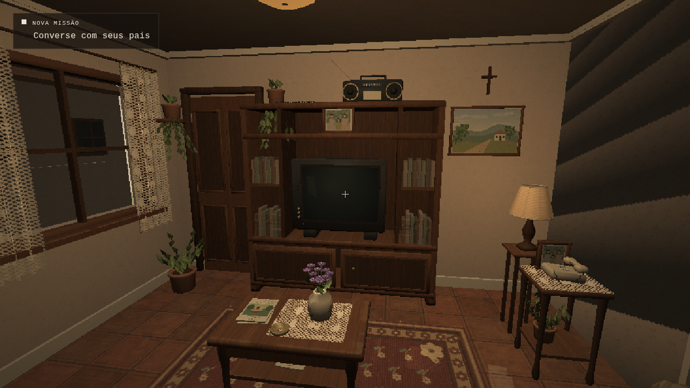
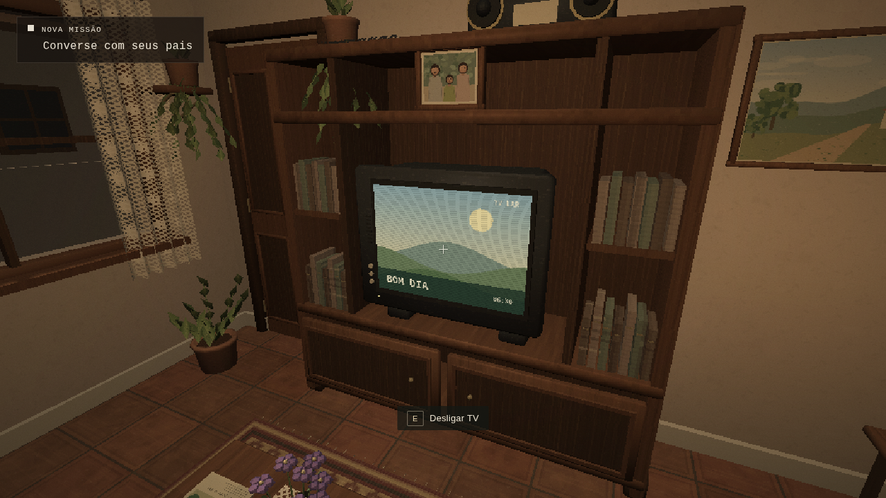

# Reconstrução e implementação — sala de estar

Esta etapa de **INTERCÂMBIO — Capítulo 1: A Despedida** acrescenta uma sala de estar explorável no térreo, seguindo a imagem principal e a prancha técnica fornecidas pelo usuário. O [Prompt Master 05](PROMPT-MASTER-05-SALA.md) registra o pedido integral. As referências orientam um único ambiente 3D; não são imagens de fundo que simulam os móveis, a escada ou a cozinha.

## Implementado

### Ambiente e materiais

A sala tem **4,20 × 3,80 m**, com pé-direito de **2,60 m**: `x = 2,67…6,87`, `z = 8,05…11,85`, piso `y = 0`. Ela ocupa o térreo a leste da escada existente. O mobiliário inclui:

- Sofá de dois lugares e poltrona com volumes arredondados, braços, almofadas, costuras, tecido xadrez terroso e renda sobre o encosto.
- Estante de nogueira com nichos, portas inferiores, puxadores, livros, rádio e CRT modelado com vidro convexo, botões e gabinete próprio.
- Mesa de centro com renda, vaso de flores, revista fictícia e objetos apoiados; tapete ornamental vinho sobre cerâmica marrom.
- Janela de madeira com vidro e cortinas rendadas com pregas, além de exterior residencial simplificado em 3D.
- Mesinha lateral com telefone antigo de teclas, fio espiralado, retrato familiar, plantas e abajur próximo.
- Porta externa com painéis, batentes, maçaneta e dobradiças, quadros neutros, fotografia dos pais com o filho e luminária de teto.

As superfícies usam materiais envelhecidos originais, não apenas cores uniformes. O módulo de materiais cria 30 texturas Canvas determinísticas, de 64 a 256 pixels por dimensão, e 31 materiais base; a montagem pode acrescentar materiais locais. Renda e crochê usam vazados, sem um retângulo opaco no lugar dos furos. Madeira, cerâmica e tecido têm escalas de UV definidas nos modelos. As malhas estáticas são agrupadas por material; as sombras da sala usam um mapa de 1024 pixels atualizado quando necessário, sem reconstruir o cenário a cada quadro.

### Percurso e adaptação da referência

O percurso mantém a descida original: **quarto → corredor → escada → patamar → entrada da cozinha → vão à direita para a sala**. Não há teleporte para explorar a sala. A composição foi adaptada à arquitetura já aprovada; a escada não foi duplicada, deslocada ou reconstruída para copiar a prancha.

A porta externa fica na parede norte (`x = 6,20`, `z = 8,05`) e permanece bloqueada. Essa posição evita modificar outra parede da cozinha ou bloquear a nova entrada. Um revestimento novo da própria sala fecha a parte inferior visível do lance, em `x = 2,305…2,329`, `z = 9,70…11,65`, sem alterar degraus ou corrimãos originais.

### Interações

Todas usam a mira central e **E**, no registro de interações existente.

| Objeto | Comportamento implementado |
| --- | --- |
| Televisão CRT | “Ligar TV” / “Desligar TV”; troca real da tela, clique discreto, ruído eletrônico suave e luz local da tela |
| Telefone da sala | “Esse telefone está aqui desde que eu era pequeno.” |
| Fotografia sobre a mesinha | “Essa foto foi tirada nas nossas últimas férias.” |
| Porta principal | “Ainda tenho algumas coisas para resolver antes de sair.”; continua bloqueada e não inicia viagem |

A imagem da TV é o programa estático original **“TV Lar / Bom Dia”**, sem transmissão ou vídeo externo. Seu áudio reutiliza o contexto, volume e pausa já utilizados pelo jogo. O ruído é não verbal, filtrado e atenuado com a distância; desligar, reiniciar ou descartar a cena libera seus nós. Não foram acrescentados vozes, TTS, narração, música licenciada, sustos, missões ou capítulos.

### Preservação e exceções de conexão

A única alteração arquitetônica nos ambientes existentes consiste em dois recortes locais:

| Superfície existente | Adaptação | Motivo |
| --- | --- | --- |
| Parede norte da cozinha | Vão entre `x = 3,25…4,15`, `z = 11,85…12,00`, altura de `2,10 m` | Passagem física de 0,90 m para a sala |
| Fechamento direito da caixa da escada | Abertura entre `x = 2,55…2,67`, `z = 9,70…11,65`, `y = 0…2,60` | Conexão visual com o lance existente; a parede superior de `y = 2,60…5,60` permanece |

A soleira ocupa somente `z = 11,85…12,00`, sem sobrepor o piso da cozinha. A alcova termina no guarda-corpo real, em `x = 2,37`, sem permitir atravessar balaústres. O retorno original ao pé da escada em `x = 2,55…3,05`, `z = 11,68…11,80` continua fechado.

A auditoria de fontes contra `d660f0a` encontrou **23 arquivos protegidos idênticos por SHA-256**, incluindo quarto, materiais dos ambientes antigos, pais, controle do jogador, história, missões, layouts originais, interface e outros cenários do capítulo. Também permaneceram idênticos os blocos que constroem o lance completo de 18 degraus e seus corrimãos, o bloco de iluminação do corredor/escada e toda a janela, mobiliário, objetos e iluminação da cozinha após seu casco.

`hallway.ts` e `kitchen.ts` receberam os recortes descritos e, portanto, não são arquivos integralmente idênticos. `main.ts`, `environment.ts`, `collision.ts` e `audio.ts` receberam a integração da sala, mantendo os sistemas existentes. A auditoria de fonte não substitui os testes de percurso e a inspeção visual.

### Arquivos e procedência

| Responsabilidade | Arquivos |
| --- | --- |
| Planta, objetos, pegadas e colisores da sala | `src/game/livingRoomLayout.ts`, `src/game/collision.ts` |
| Malhas, agrupamento, iluminação e TV | `src/scene/livingRoom.ts`, `src/scene/livingRoomGeometry.ts` |
| Materiais, retratos, paisagens e programa fictício da TV | `src/scene/livingRoomMaterials.ts` |
| Conexões físicas locais | `src/scene/hallway.ts`, `src/scene/kitchen.ts` |
| Registro de interações, diagnóstico e ciclo de vida | `src/scene/environment.ts`, `src/main.ts` |
| Clique e ruído eletrônico local | `src/game/audio.ts` |
| Unidades e percurso real de navegador | `tests/livingAudio.test.mjs`, `tests/livingRoomCollision.test.mjs`, `tests/living-room-route.mjs`, `tests/living-room-browser.mjs` |
| Ajuste de amostra de parede fora do novo vão | `tests/kitchenCollision.test.mjs` |
| Execução automatizada e escopo do projeto | `package.json`, `scripts/verify.mjs`, `AGENTS.md` |
| Documentação, procedência e evidências | `README.md`, `THIRD_PARTY_NOTICES.md`, `docs/PROMPT-MASTER-05-SALA.md`, `docs/RECONSTRUCAO-SALA.md`, `docs/resultados-sala.json`, os dez PNGs `docs/capturas/sala-*.png` relacionados abaixo |

Os modelos, padrões de tecido, renda, cerâmica, fotografias familiares fictícias e paisagens foram criados por código para este projeto. Não foram baixados modelos, texturas, fotos de pessoas ou pacotes de áudio. A [relação de fontes e licenças](../THIRD_PARTY_NOTICES.md) detalha a procedência e as licenças das dependências. O retrato individual da menina não foi usado.

## Testado

Rodada concluída em **8 de novembro de 2026**, no fuso `America/Sao_Paulo`. O [registro de resultados](resultados-sala.json) contém os dados da suíte final, poses da câmera, hashes dos PNGs e do bundle, proveniência das regressões e auditoria de preservação. A versão final usa `dist/assets/index-u8prfp0f.js`.

| Verificação executada | Resultado |
| --- | --- |
| `npm run typecheck` | Aprovado |
| `npm test` | **58/58 testes aprovados**, sem falhas |
| `npm run build` | Aprovado; bundle principal de 1.500,60 kB, 394,33 kB com gzip |
| `CHROMIUM_PATH=/usr/bin/chromium npm run verify` | Aprovadas sala, regressões do corredor e quarto e sequência completa do capítulo |
| Suíte integral da sala no build final | Aprovados novo despertar, descida real, dez vistas, TV/áudio, objetos, colisões e retorno à cozinha |
| Auditoria das fontes preservadas | 23 arquivos e três blocos protegidos idênticos ao baseline |

As seis novas unidades de áudio verificam contexto compartilhado, ciclo de vida, volume, distância, pausa, reinício, falha local e coordenadas reais de `Vector3` do Babylon. As seis de colisão da sala verificam a ida e volta pelo vão, pegadas giradas, paredes, porta, janela, objetos de apoio, guarda-corpo e retorno de alvenaria. A regressão do capítulo percorreu café, diálogo somente por texto, escolha, restauração real do checkpoint, mala, carro, aeroporto, avião e chegada à família anfitriã.

As regressões dos ambientes preservados foram concluídas antes de dois ajustes restritos à sala: orientação UV do CRT e simplificação das pequenas flores. Em seguida, TypeScript, as 58 unidades, o build e **toda a suíte da sala** foram executados novamente; as dez capturas publicadas pertencem a esse build final. As fontes protegidas continuaram idênticas.

### Interações e áudio em execução

A suíte moveu o jogador por controles reais, desde o despertar, sem alterar sua posição por um setter de diagnóstico. Confirmou a descida dos 18 degraus, passagem física até a sala e retorno à cozinha com o objetivo original **“Converse com seus pais”**. As três legendas de telefone, fotografia e porta coincidiram com os textos do pedido; nenhuma iniciou missão ou viagem. Mesa, janela e porta bloquearam o jogador, e decorações não exibiram prompts sem função.

A TV foi ligada e desligada por mira e **E**, com pausa e retomada entre as alternâncias. O centro da face do CRT mudou de luminância média **26,49 → 135,68 → 26,60**, enquanto a imagem original apareceu e voltou a apagar. O analisador exclusivo do áudio da TV mediu RMS antes do volume principal de **0 → 0,00463552 → 0**; na pausa, sinal e ganho efetivo também ficaram em zero. Isso confirma sinal eletrônico produzido e interrompido no navegador, sem constituir uma avaliação de escuta humana.

### Dez capturas reais

Todos os PNGs abaixo foram produzidos pelo navegador no build final, entre **00:27 e 00:30 de 08/11/2026**, horário de São Paulo. São cópias sem alteração de pixels, com hashes no JSON. Os quadros internos usados nas verificações de imagem permaneceram temporários; suas dimensões e hashes também estão registrados. Nenhuma imagem conceitual ou gerada é usada como evidência de execução.

| Vista requerida | Captura nativa, 1280 × 720 |
| --- | --- |
| 1. Base da escada | [Sala a partir do patamar](capturas/sala-base-escada.png) |
| 2. Entrada da cozinha | [Novo vão físico](capturas/sala-entrada-cozinha.png) |
| 3. Visão geral | [Área de estar](capturas/sala-visao-geral.png) |
| 4. Sofá e poltrona | [Estofados e circulação](capturas/sala-sofa-poltrona.png) |
| 5. Mesa e tapete | [Mesa de centro e cerâmica](capturas/sala-mesa-tapete.png) |
| 6. Estante e televisão | [CRT desligado](capturas/sala-estante-tv.png) |
| 7. Janela e manhã | [Renda, vidro e exterior](capturas/sala-janela-manha.png) |
| 8. Televisão ligada | [Programa original no CRT](capturas/sala-tv-ligada.png) |
| 9. Porta principal | [Porta bloqueada](capturas/sala-porta-principal.png) |
| 10. Conexão com a escada | [Lance original e novo acabamento](capturas/sala-conexao-escada.png) |





### Comparação visual

A inspeção das dez vistas confirmou posições consistentes de sofá, poltrona, janela, estante, mesa e objetos. Estofados têm braços e almofadas visíveis, a renda apresenta vazados, os objetos estão apoiados, e a TV mostra “TV Lar / Bom Dia” na orientação correta. A ligação expõe a escada real e a cozinha existente pelo vão; o acabamento sob o patamar fecha a vista indevida do exterior.

A composição e os materiais seguem a direção brasileira retrô, mas **não são uma reprodução exata** das referências. Os desenhos de família, paisagens, tapete e tecidos são autorais e têm menos detalhe. A iluminação por luzes locais e mapas de sombra difere da iluminação conceitual; o exterior da janela é simplificado. A escada reta e sua caixa preservada, a passagem pela entrada da cozinha e a posição da porta principal também mudam o enquadramento. A apresentação destas capturas não presume aprovação artística do usuário.

### Desempenho medido

Ambiente: **Node.js 24.19.0, Chromium 154.0.8037.57, Debian 13/Linux, WebGL 2 e SwiftShader**, sem GPU física. Perfil **Equilibrado**, janela de **1280 × 720** e framebuffer interno de **914 × 514**.

| Intervalo observado | Quadros | Tempo real | Deslocamento amostrado | FPS medidos |
| --- | ---: | ---: | ---: | ---: |
| Câmera parada na sala | 65 | 10,00399954 s | — | **6,5** |
| Exploração com entradas reais W/S | 96 | 10,09462551 s | 2,999 m | **9,5** |

Cada taxa foi calculada pelos quadros renderizados durante seu próprio intervalo de relógio. A exploração inclui o custo de controle e leitura de posições da automação; seu deslocamento amostrado é um limite inferior da distância percorrida. O indicador móvel de FPS do jogo usa outra janela de amostragem e não substitui esses intervalos.

A cena inteira carregada contém **346 malhas e 169.689 vértices**; esses números não descrevem apenas a sala. As pequenas partes das flores usam malhas facetadas reduzidas, e a aparência foi conferida nas capturas. A redução geométrica não é apresentada como ganho de FPS presumido. O build exibe o aviso de chunk minificado acima de 500 kB; ele concluiu normalmente.

**As taxas medidas são baixas e não comprovam fluidez confortável ou 60 FPS.** Não foi medido o computador do jogador, uma GPU física ou o Windows.

## Pendente

- Validar desempenho em GPU física, Windows e outros equipamentos do jogador.
- Avaliar volume e timbre da TV por escuta humana; o analisador comprova sinal, não sua qualidade percebida.
- Receber avaliação artística do usuário, considerando os limites da comparação acima.
- Verificar um deployment público da Vercel. Nesta etapa, o build de teste foi servido por HTTP local.

## Executar e verificar

Requer Node.js 24 ou superior. Na pasta do projeto:

```bash
npm ci
npm run dev
```

Abra `http://localhost:5180`. Se o checkpoint estiver avançado, use **Esc → Reiniciar cena**. Saia do quarto, desça a escada e vire à direita na entrada da cozinha para encontrar a nova passagem.

```bash
npm run typecheck
npm test
npm run build
CHROMIUM_PATH=/usr/bin/chromium npm run verify
```

O último comando usa Chromium instalado e inicia uma prévia temporária do build de produção. Para executar somente a suíte da sala contra um servidor já aberto, use `INTERCAMBIO_URL=http://localhost:5180 npm run test:living-room`. No Windows, defina as variáveis com a sintaxe de seu terminal e indique o caminho de seu Chromium/Chrome se a descoberta automática não encontrar o navegador.

O build fica em `dist/` e deve ser servido por HTTP. Não abra o HTML por `file://`. Esta documentação não presume que uma atualização esteja publicada em um endereço da Vercel sem verificar o deployment correspondente.
