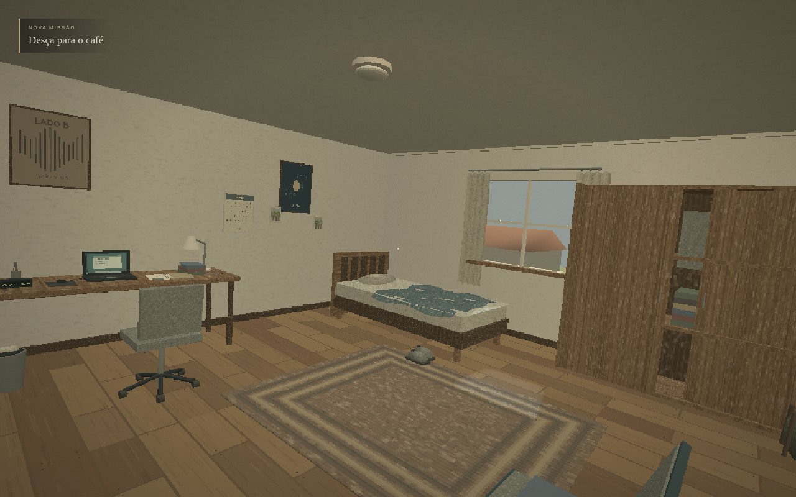
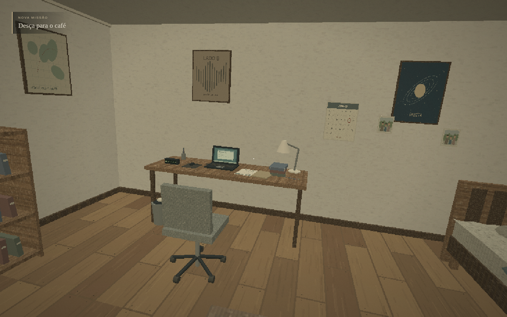

# Verificação — O Despertar

O projeto independente **O Intercâmbio — Protótipo 01** passou na verificação completa registrada em **7 de novembro de 2026, UTC**: TypeScript, **35 testes unitários aprovados e zero falhas**, build de produção e quatro perfis de navegador. Os números e o escopo de cada perfil estão no [relatório de resultados](resultados-navegador.json).

O ambiente foi **Node.js 24.19.0, Chromium 154.0.8037.57, Debian 13/Linux e SwiftShader**, com janela de **1280 × 800**. A execução usou renderização por software. GPU física e Windows não foram medidos.

## Resultados executados

Equilibrado concluiu o fluxo completo: despertar, legenda e fala da mãe, movimentação, colisões, três objetos opcionais, interruptor, abertura/fechamento da porta, corredor, descida da escada e tela final. Também passaram pausa, retomada, repetição da abertura e persistência das configurações após recarregar.

Baixo repetiu o percurso obrigatório até o fim sem examinar objetos opcionais. Alta e WebGL 1 passaram na abertura, nas imagens e no benchmark; esses dois perfis não repetiram todo o percurso. O contexto de WebGL 1 confirmou a versão 1 em execução e usou qualidade Baixa.

A suíte não registrou exceções de página, erros de console/shaders ou falhas de arquivos locais nos quatro perfis. Também foram verificados em Linux a resposta HTTP do jogo, o WAV local e a escolha da porta **5196** pelo inicializador Node quando **5195** estava ocupada. O `.bat` não foi executado no Windows.

O build Vite passou e manteve o aviso de chunk principal acima de 500 kB: **1.329,65 kB**, ou **331,18 kB com gzip**. O aviso continua registrado como uma limitação de empacotamento.

## Desempenho medido

Cada amostra observou dez segundos reais logo após a abertura, com o personagem parado na mesma posição de pé. A coluna FPS usa a diferença de quadros renderizados dividida pelo tempo real. Média e P95 são os valores da janela de amostragem do indicador do jogo.

| Perfil | WebGL | Resolução interna | Quadros / intervalo real | FPS medidos | Média (ms) | P95 (ms) |
| --- | ---: | ---: | ---: | ---: | ---: | ---: |
| Equilibrado | 2 | 914 × 571 | 105 / 10,005 s | 10,5 | 96,5 | 132,1 |
| Baixo | 2 | 581 × 363 | 145 / 10,012 s | 14,5 | 69,3 | 93,1 |
| Alto | 2 | 1280 × 800 | 79 / 10,002 s | 7,9 | 126,3 | 199,5 |
| Baixo / WebGL 1 | 1 | 581 × 363 | 145 / 10,008 s | 14,5 | 70,9 | 105,4 |

**A meta de 60 FPS não foi atingida neste ambiente de renderização por software.** Esses resultados não permitem afirmar desempenho em GPU física ou no computador Windows do jogador. Eles representam câmera parada nessa cena e nessa configuração, não uma medição de todos os movimentos ou aparelhos possíveis.

## Capturas da execução

A rodada produziu **27 capturas da página em resolução nativa** e **21 quadros internos do WebGL**. As perspectivas abaixo foram alcançadas pela movimentação e pelo mouse reais, sem teletransporte:





Também foi extraído o ZIP de entrega em uma pasta sem `node_modules`. O servidor estático incluído iniciou apenas com Node.js; uma nova rodada de teclado e mouse percorreu o build extraído, observou a vizinhança pela janela e os degraus com a câmera inclinada para baixo, abriu a porta e chegou novamente ao final. Não houve erros de página, console ou arquivos nesse percurso. O código executável do ZIP final é idêntico ao dessa conferência; depois dela foram acrescentadas somente documentação e capturas.

Veja as capturas reais da [janela](capturas/janela.png), da [escada](capturas/escada.png) e do [final](capturas/fim.png).

## Reproduzir a verificação

```sh
npm ci
CHROMIUM_PATH=/usr/bin/chromium npm run verify
```

`verify` executa TypeScript, testes de regras e build. Em seguida abre a versão de produção por HTTP na porta temporária 4181 e percorre a cena com Chromium. A prévia é encerrada ao fim da verificação. Não há uso de `file://`.

Com o servidor de desenvolvimento já ativo na porta 5180, a suíte também pode ser executada separadamente:

```sh
CHROMIUM_PATH=/usr/bin/chromium npm run test:browser
```

## Fluxo exercitado

A suíte usa somente controles de interface, teclado e mouse para jogar. O diagnóstico `window.__INTERCAMBIO__` é consultado para observar câmera, estado, porta e métricas; não oferece nem recebe teletransporte, conclusão forçada ou avanço de relógio.

No perfil Equilibrado, a sequência acompanha a abertura até 13,5 segundos no relógio da cena: preto, abertura parcial para o teto, piscada, fala e legenda exatas da mãe, sentar e levantar. O teste verifica que os comandos de movimento não deslocam o protagonista deitado. Depois percorre o quarto, verifica colisão com cama e parede, examina mala/calendário/fotografia e alterna a luz.

A porta é aberta, fechada e aberta novamente. O teste observa ângulos intermediários, confirma o bloqueio físico quando fechada e atravessa a abertura somente quando ela permite passagem. Percorre corredor e escada pela movimentação normal, verificando a redução da altura dos olhos e que a missão ainda está ativa antes do último degrau. A tela final só é aceita após alcançar a parte inferior.

Também são exercitados pausa, retomada, preferências de sensibilidade/balanço/volume/legendas/granulação, persistência após recarregar e reinício com repetição da abertura. O perfil Baixo repete a saída sem examinar objetos opcionais, para comprovar que eles não bloqueiam o objetivo principal. Alta e WebGL 1 recebem verificações de imagem e medição do cenário em execução.

O parâmetro `INTERCAMBIO_PROFILES=balanced,low,high,webgl1` permite selecionar perfis para diagnóstico. Uma execução parcial deve ser relatada como parcial.

## Imagens e desempenho

As capturas reais ficam em `/tmp/o-intercambio-*.png`: imagem da página em resolução nativa e quadro interno do WebGL com a resolução retrô correspondente. Os testes analisam pixels do cenário; a inspeção visual das capturas continua necessária.

O relatório bruto `/tmp/o-intercambio-browser-results.json` contém imagens, perfis e medições. A cópia [resultados-navegador.json](resultados-navegador.json) preserva os valores medidos e o escopo efetivamente exercitado, sem depender dos caminhos temporários das capturas.

A fala da mãe é um arquivo local sintético e provisório, substituível por gravação humana. Durante a abertura Equilibrada, a suíte exigiu a legenda exata e `voice.played === true`. O snapshot final desse perfil foi obtido **depois de recarregar a página**; por isso seus campos finais `ready` e `played` estão falsos. Esses campos não representam o momento anterior da fala, nem foram alterados no relatório para parecerem verdadeiros. A reprodução do arquivo e a legenda funcionaram; não se trata de dublagem humana natural.
